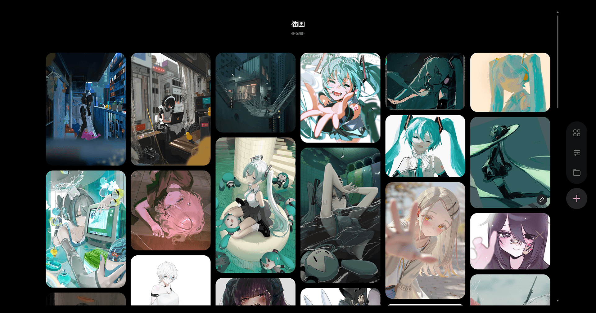
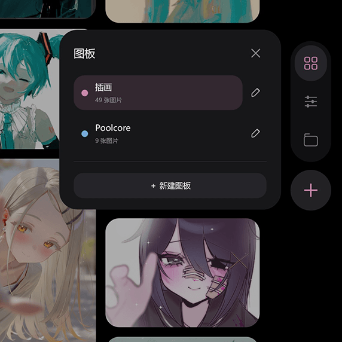
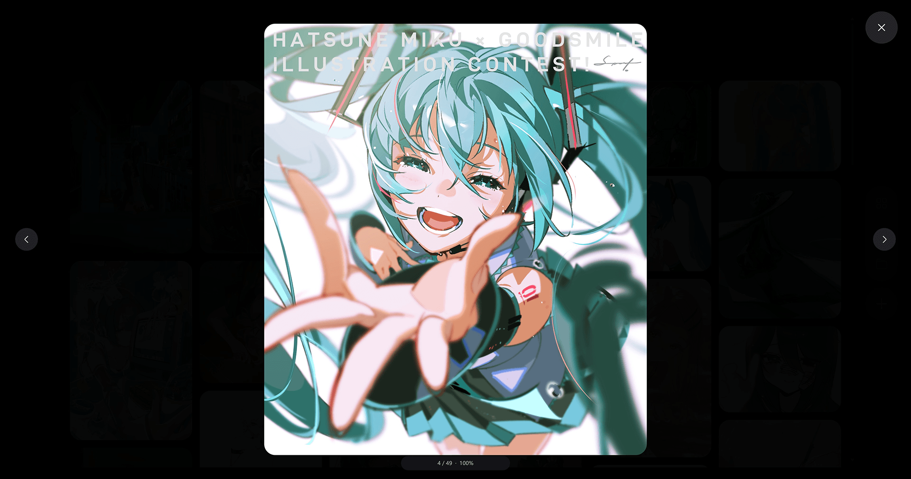

# huahua-board
# 画画图板

一个轻量、简洁的 Windows 本地参考图板。

把喜欢的图片收集到一起，用于绘画参考、场景设计和灵感整理。

## 功能

- 创建多个图板，分类整理图片
- 导入本地图片，使用瀑布流浏览
- 拖动图片调整顺序
- 重命名图片和图板
- 为不同图板设置强调色
- 调整图板宽度和图片显示大小
- 放大查看图片，滚轮缩放、拖动查看细节

## 下载与使用

前往本仓库的 Releases 页面，下载最新的 Windows x64 ZIP 压缩包。

完整解压后，双击「画画图板.exe」运行。

请保留压缩包内的配套文件，不要只取出 EXE。

## 界面预览

### 图板管理

### 图片预览

## 开源与许可

画画图板是一个个人开源项目，原创程序代码采用 MIT 许可证。

你可以使用、修改和分发这些代码，也可以用于商业项目，
但需要保留原有版权声明和 MIT 许可证。

完整许可请查看 [LICENSE](LICENSE)。

第三方组件遵循各自的许可证。
应用图标不包含在 MIT 授权范围内，详见
[图标说明](ASSETS_NOTICE.txt)。

如果这个小工具对你有帮助，欢迎点一个 Star。
也欢迎通过 Issues 反馈问题和建议。

## 问题与建议

如果遇到问题，或者有功能建议，欢迎在 Issues 中提出。

反馈问题时，请尽量附上：
- 软件版本
- Windows 版本
- 出现问题前的操作
- 截图或录屏
